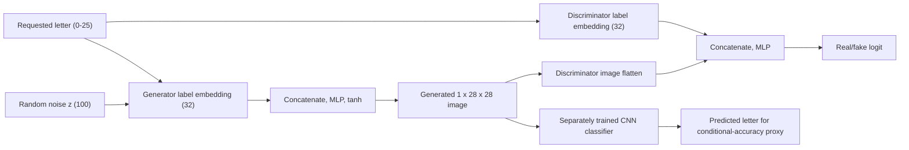

# Architecture

The project uses EMNIST **Letters** (A-Z, 26 classes), with 28 x 28 grayscale
images. The dataset's labels (1-26) are remapped to 0-25. Image orientation is
corrected for normal reading and pixels are normalized to [-1, 1].

## Components and objective

- **Generator:** embeds the requested class, concatenates it with a 100-value
  noise vector, and uses fully connected layers to produce 784 pixels. `tanh`
  matches the normalized image range.
- **Discriminator:** concatenates a flattened image and an embedding of the
  requested class, then produces one real/fake logit. `BCEWithLogitsLoss`
  combines the binary classification loss and sigmoid operation safely.
- **Training:** discriminator learns from correctly paired real examples and
  generated examples. Generator learns to make generated images score as real
  for their requested class. Real targets are smoothed to 0.9.
- **Evaluation CNN:** trained separately on real EMNIST train images and
  checked against EMNIST test images. Its predictions on generated images
  estimate whether the requested class is recognizable. This metric is not a
  human judgment or a complete measure of image quality.

The generator is an MLP, not a convolutional network. This keeps the project
small and understandable; convolutional GANs are a natural extension.
